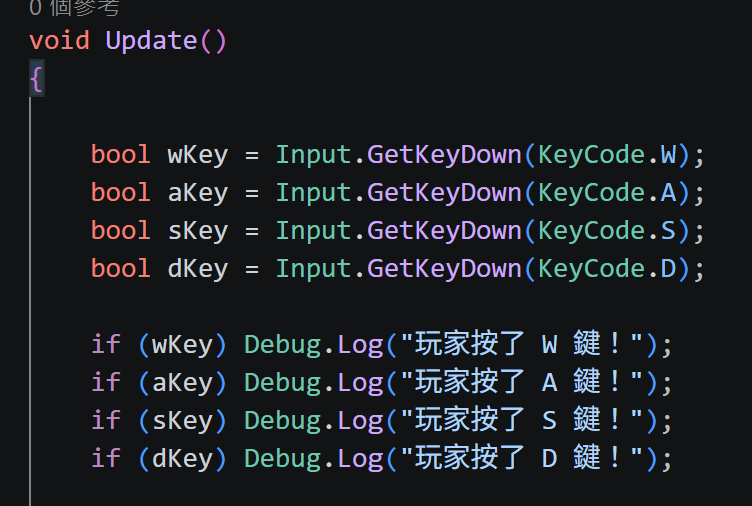
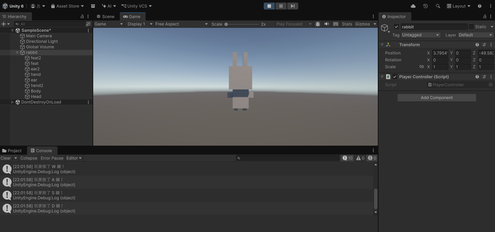
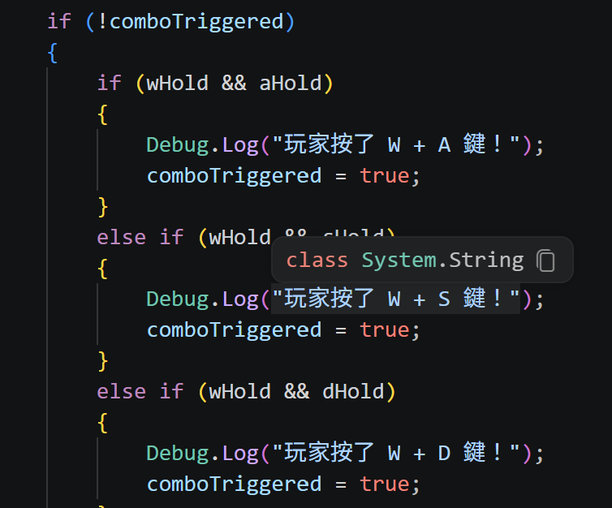
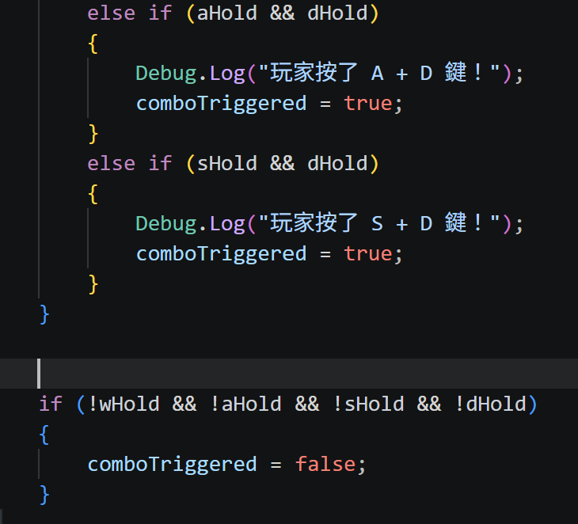
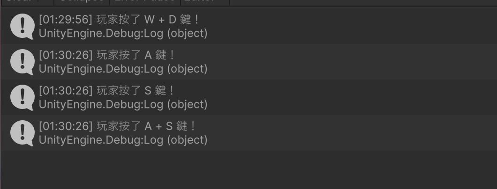
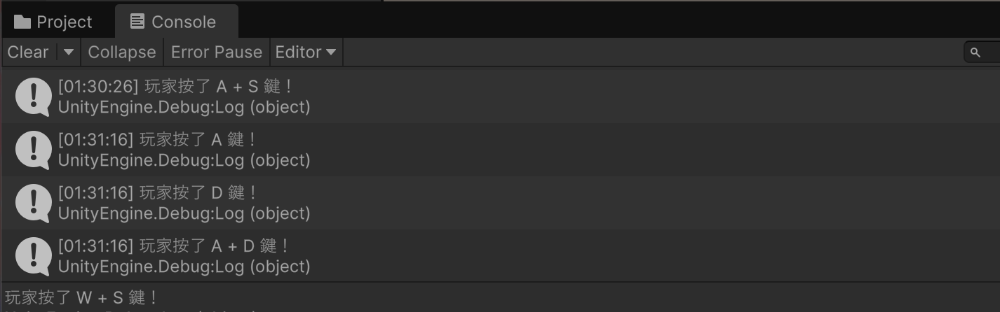
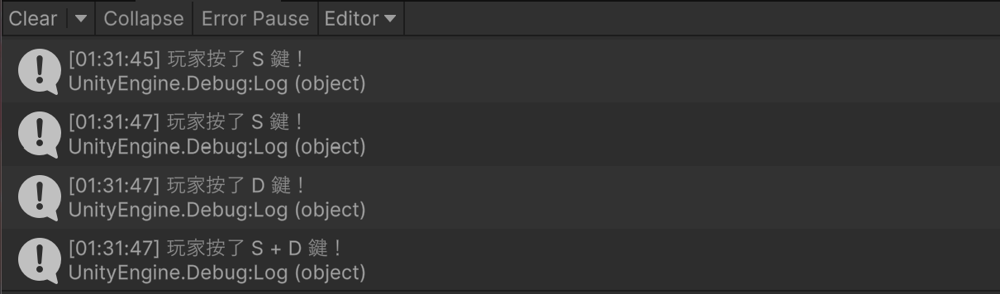
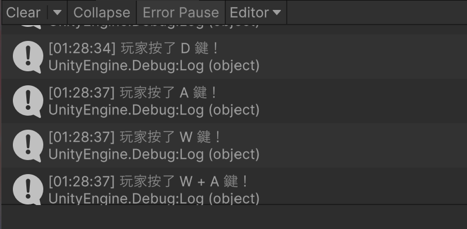
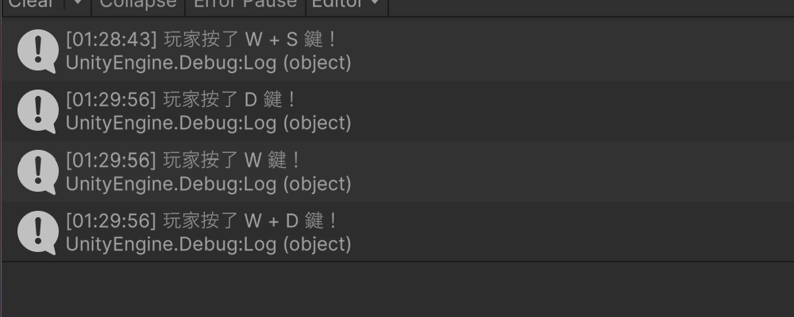
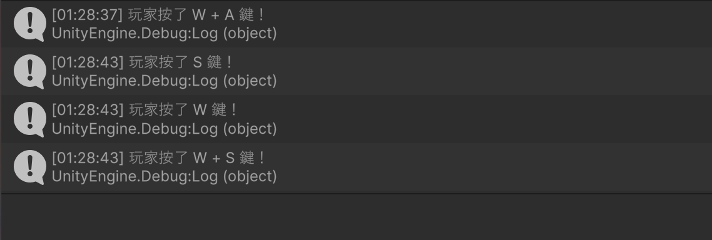

# 第2次作業題目-作業-HW2
>
>學號：113111129 (換成自己的)
><br />
>姓名：呂霽芳(換成自己的)
><br />
>作業撰寫時間：100 (mins，包含程式撰寫時間，換成自己的)
><br />
>最後撰寫文件日期：2026/11/01 (換成自己的)
>

本份文件包含以下主題：(至少需下面兩項，若是有多者可以自行新增)
- [x] 說明內容
- [x] 其他 (可以包含心得或是想跟老師反映)

## 說明內容

開始寫說明，該說明需說明想法，
並於之後再對上述想法的每一部分將程式進一步進行展現，
若需引用程式區則使用下面方法，
若為.cs檔內程式除了於敘述中需註明檔案名稱外，
還需使用語法` ```語言種類 程式碼 ``` `，其中語言種類若是要用python則使用py，java則使用java，C/C++則使用cpp，
下段程式碼為語言種類選擇csharp使用後結果：

```csharp
public void mt_getResult(){
    ...
}
```

若要於內文中標示部分網頁檔，則使用以下標籤` ```html 程式碼 ``` `，
下段程式碼則為使用後結果：

```html
<%@ Page Language="C#" AutoEventWireup="true" ...>

<!DOCTYPE html>

<html xmlns="http://www.w3.org/1999/xhtml">
<head runat="server">
<meta http-equiv="Content-Type" ...>
    <title></title>
</head>
<body>
    <form id="form1" runat="server">
        <div>
        </div>
    </form>
</body>
</html>
```
更多markdown方法可參閱[https://ithelp.ithome.com.tw/articles/10203758](https://ithelp.ithome.com.tw/articles/10203758)

請在撰寫"說明程式與內容"該塊內容，請把原該塊內上述敘述刪除，該塊上述內容只是用來指引該怎麼撰寫內容。

1. 


    a.

Ans:

程式:bool wKey = Input.GetKeyDown(KeyCode.W);
bool aKey = Input.GetKeyDown(KeyCode.A);
bool sKey = Input.GetKeyDown(KeyCode.S);
bool dKey = Input.GetKeyDown(KeyCode.D);

if (wKey) Debug.Log("玩家按了 W 鍵！");
if (aKey) Debug.Log("玩家按了 A 鍵！");
if (sKey) Debug.Log("玩家按了 S 鍵！");
if (dKey) Debug.Log("玩家按了 D 鍵！");

Input.GetKeyDown(鍵)的意思：**只在「按下那一瞬間」的影格回傳 true**，按住不放不會重複觸發。
四個變數分別記錄 W、A、S、D 這一幀有沒有被按下。
哪個變數是 true，就印出對應訊息到 Console。




    b. 

Ans:

程式:
bool wHold = Input.GetKey(KeyCode.W);
bool aHold = Input.GetKey(KeyCode.A);
bool sHold = Input.GetKey(KeyCode.S);
bool dHold = Input.GetKey(KeyCode.D);

if (wHold && aHold)
{
    Debug.Log("玩家按了 W + A 鍵！");
    comboTriggered = true;
}










 其他:我前面單鍵一次就成功了，但是加上雙鍵就一直報錯不然就是一直重複，重改了好多次才能成功